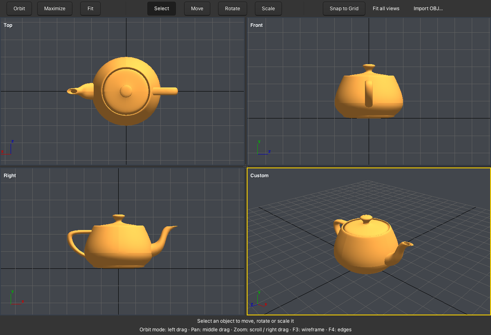

# 3dWhiz

[](https://github.com/mirzahusadzic/3dwhiz/actions/workflows/ci.yml)
[](LICENSE)
[](CMakeLists.txt)
[](https://www.gtk.org/)

My old C++ 3D editor, brought back to life with GTK 3. Four viewports, camera
controls, object picking, and custom move/rotate/scale gizmos.

<p align="center">
  <a href="docs/images/teapot.png">
    
  </a>
</p>

<p align="center">
  <em>The Utah teapot, naturally. Model by Martin Newell, via
  <a href="https://github.com/alecjacobson/common-3d-test-models">common-3d-test-models</a>.</em>
</p>

## A small time capsule

I built this as a hobby project, inspired by the viewport workflow and transform
gizmos of 3ds Max. Underneath is a reusable editor framework built with C++, GTK,
GObject and fixed-function OpenGL. The custom four-pane widget and transform
gizmos were among my favourite parts.

Originally developed on Windows and tested on Ubuntu, it survived in an archive
I emailed myself on 13 April 2014. Recovered in October 2026, ported to GTK 3,
tested on macOS, and prepared for release with Astra in a single afternoon.
The original [development notes](src/txt) are still here, just as I left them.

## Stack

| Part | Technology |
| --- | --- |
| Language | C++14, with C/GObject APIs |
| UI | GTK 3.24+, GLib, custom four-pane container |
| Rendering | Compatibility OpenGL, CGL on macOS, GDK/libepoxy on Linux |
| Text and presentation | Pango and Cairo |
| Models | Wavefront OBJ, procedural cube and torus |
| Build and tests | CMake 3.20+, CTest, GLib tests, GTK interaction checks |
| CI | GitHub Actions, GCC/Clang, AddressSanitizer and UndefinedBehaviorSanitizer |

## Build and run

### macOS

Install Xcode Command Line Tools and Homebrew, then:

```sh
brew install cmake gtk+3 pkgconf
cmake -S . -B build -DCMAKE_BUILD_TYPE=Debug
cmake --build build --parallel
./build/3dwhiz-demo
```

### Linux

On Ubuntu or Debian:

```sh
sudo apt-get install build-essential cmake pkg-config libgtk-3-dev \
  libepoxy-dev libgl1-mesa-dev libglu1-mesa-dev
cmake -S . -B build -DCMAKE_BUILD_TYPE=Debug
cmake --build build --parallel
./build/3dwhiz-demo
```

The GTK 3 port has been exercised locally on Apple Silicon macOS. CI is
configured for Ubuntu and macOS; the Windows port has not been verified.
Use CMake for the port; the original Makefiles are historical.

## Bring your own teapot

The demo starts with a cube and torus. Use **Import OBJ…** to add a model, or
start with one from the command line:

```sh
./build/3dwhiz-demo --model /path/to/model.obj
```

To try the model shown above:

```sh
mkdir -p .local/models
curl -fL https://raw.githubusercontent.com/alecjacobson/common-3d-test-models/master/data/teapot.obj \
  -o .local/models/teapot.obj
./build/3dwhiz-demo --model .local/models/teapot.obj
```

OBJ import supports positive and negative indices, separate normal indices,
optional UVs/normals, triangles, and convex polygon fans. Smooth vertex normals
are generated when none are supplied. Materials, textures, smoothing groups,
and concave polygon triangulation are not supported; triangulate complex faces
in the exporting application. Meshes support up to 65,535 remapped vertices.

## Controls

- **Select:** click an object; click the background to deselect.
- **Move**, **Rotate**, **Scale:** drag the selected object or its gizmo. Rotate
  freely by dragging the body, constrain rotation with a coloured ring, or use
  the outer ring to rotate in the camera plane. Scale has uniform and axis handles.
- **Snap to Grid:** show the nearest grid point under the pointer. This is a
  cursor aid; it does not constrain object movement.
- **Orbit:** left-drag to orbit, middle-drag to pan, right-drag or scroll to zoom.
- **Fit:** fit the focused viewport to the selection or scene.
  **Fit all views:** fit all four cameras.
- **Maximize:** expand the focused viewport; click again to restore.
- Drag either divider, or their intersection, to resize the views. Right-click
  a divider for **Reset Layout**.
- **F3:** toggle wireframe. **F4:** toggle edges. **Tab:** cycle viewport focus.

## Tests and CI

The parser, geometry and math checks run without a display:

```sh
ctest --test-dir build --output-on-failure
```

Enable the editor checks when a desktop session and compatibility OpenGL are
available:

```sh
cmake -S . -B build -DWHIZ_UI_TESTS=ON
cmake --build build --parallel
ctest --test-dir build --output-on-failure
```

The UI test drives GTK interactions, checks rendered transforms, exercises the
file chooser and viewport layout, and saves screenshots in the build directory.
It uses in-memory settings so file-chooser preferences stay unchanged. For a
separate run with the teapot:

```sh
G_DEBUG=fatal-warnings GSETTINGS_BACKEND=memory \
  ./build/3dwhiz-demo --model .local/models/teapot.obj --smoke-test
```

For AddressSanitizer and UndefinedBehaviorSanitizer:

```sh
cmake -S . -B build-sanitize -DCMAKE_BUILD_TYPE=Debug \
  -DWHIZ_SANITIZERS=ON -DWHIZ_UI_TESTS=ON
cmake --build build-sanitize --parallel
UBSAN_OPTIONS=halt_on_error=1 ctest --test-dir build-sanitize --output-on-failure
```

[CI](.github/workflows/ci.yml) runs on pushes to `main`, pull requests and manual
dispatches. Ubuntu/GCC runs the unit and UI checks with Mesa software rendering
under Xvfb. Ubuntu/Clang and macOS/Apple Clang build and run the unit checks with
sanitizers. Test reports and UI screenshots are retained as workflow artifacts.
The teapot is optional local test data; CI uses the built-in scene.

See [the port notes](docs/PORTING.md) for the rendering approach and current
limits, and [CONTRIBUTING.md](CONTRIBUTING.md) for working on the code.

## License

[MIT](LICENSE), with [third-party notices](THIRD_PARTY_NOTICES.md).
